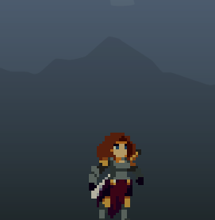
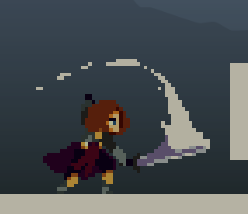
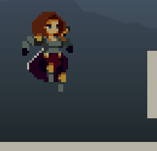
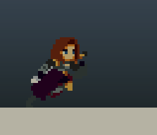

# ✨ Player Movement Controller

### *Smooth physics, snappy turns, no infinite jumping*

> *One script that handles running, jumping, attacking and looking cool while doing it.*

| | |
|:---:|:---:|
|  |  |
|  |  |

---

## ✨ How it works

The script drives movement through `Rigidbody2D`, so the character obeys gravity and collisions like everything else in the scene.

| Function | What it does |
| :--- | :--- |
| `handleinput()` | Listens for Space (jump) and Mouse0 (attack). |
| `tryToJump()` | Only applies force when `isGround` is true. |
| `flip()` | Rotates the sprite 180° so it faces the direction of travel. |
| `OnDrawGizmos()` | Draws the ground raycast in the editor so you can see it working. |

### Key choices

- **Horizontal movement** uses `Input.GetAxisRaw` — snappy and responsive, no floaty acceleration.
- **Ground check** is a short raycast, so coyote jumps and double jumps don't happen by accident.
- **Attack hook** fires `tryToATT()` on click, ready to drive an Animator state.
- **Animation sync** pushes `xVelocity` and `yVelocity` into the Animator so run and fall states match the physics.

---

## 📝 Setup

1. **Attach** `playerMovement.cs` to your Player GameObject.
2. **References** — it finds `Rigidbody2D` and `Animator` on `Awake()`.
3. **Layers** — set the *"Whats The Layer"* field in the Inspector to your Ground layer, otherwise you will never leave the floor.

> *Dev note: updated to `rb.linearVelocity` for Unity 6 physics.*

---

   
  <i>"fixing the double tryToJump shit" — A Legacy</i> ✨
    
  Built by <b>Abdullah Aljuaid</b> · <a href="https://github.com/CipherS88">@CipherS88</a>

